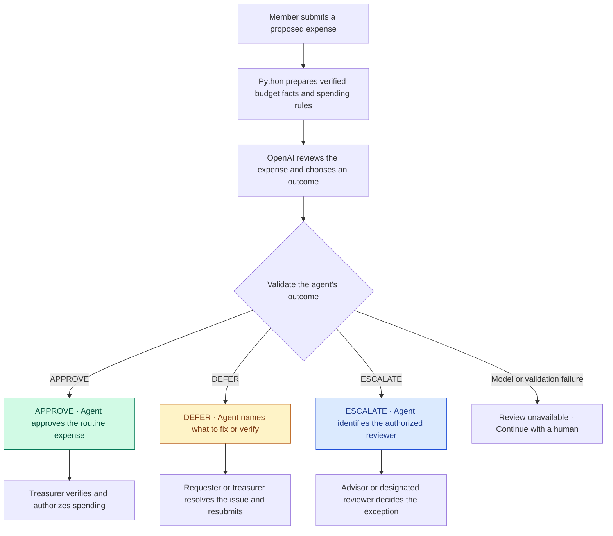
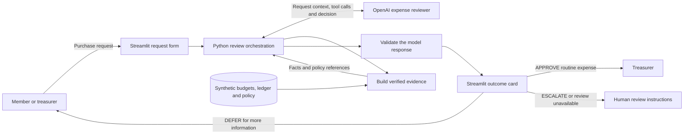
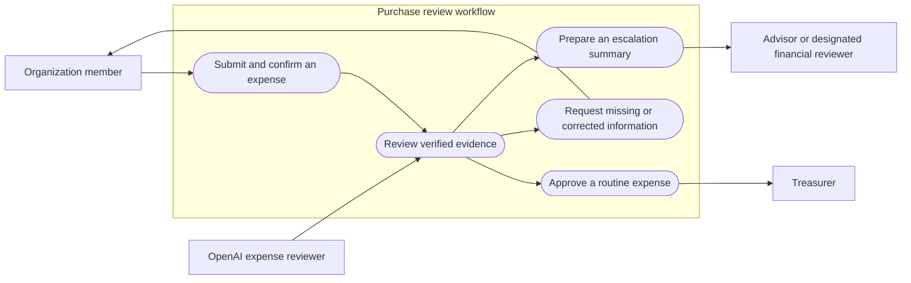
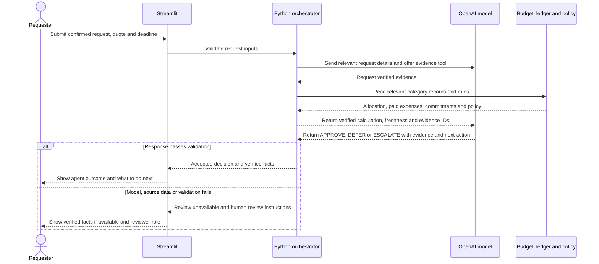

# Campus Organization Spending Review Agent

The agent reviews one proposed purchase at a time and returns **APPROVE**, **DEFER**, or **ESCALATE**. In the target design, **OpenAI makes that decision** using the purchase details, verified budget figures, and the club's spending rules. Streamlit shows the outcome, the calculation behind it, and what to do next.

The Team Smile project proposal gives the treasurer responsibility for authorizing actual spending. **APPROVE** completes the agent's review of a routine expense. The treasurer verifies the result before committing funds. **ESCALATE** sends a different signal: the request needs judgment or authority beyond the routine review, such as a budget transfer or an exception. The prototype uses synthetic data and illustrative policies.

**Status:** The diagrams show the target design. See [Running the current prototype](#running-the-current-prototype) for the Python-led version available today.

## How the agent handles an expense



Streamlit displays an agent outcome only after the response passes validation. The outcome card leads with the decision and the next action. The requester can expand the budget calculation, policy citations, and unresolved items.

| Outcome | When the agent uses it | What happens next |
|---|---|---|
| **APPROVE** | The expense fits the verified balance, satisfies policy, and has sufficient evidence. | The routine review is complete. The treasurer verifies the figures and authorizes the expense through the club's process. |
| **DEFER** | An issue can be resolved before the deadline, such as a missing quote, conflicting costs, an uncertain category, or stale records. | The agent names the issue and who can resolve it. The requester resubmits once it is resolved. |
| **ESCALATE** | The request exceeds funds, hits an authorization threshold, falls under a restriction, or needs urgent human judgment. | The agent gives the requester a summary and the configured reviewer role. The requester shares it manually. |
| **Review unavailable** | Source records cannot be validated, the model is unavailable, or its response fails validation. | The app shows verified facts if available and directs the requester to a human reviewer. |

### Examples from the proposed workflow

| Request | Verified evidence | Expected outcome |
|---|---|---|
| A complete $100 Travel shuttle request | The category has $300 available after commitments. The expense fits and no special authorization applies. | **APPROVE** · Proceed to routine treasurer verification. |
| A $450 Travel van rental with a reservation expiring tomorrow | $2,000 allocated − $800 paid − $900 committed = $300 available. The request has a $150 shortfall. | **ESCALATE** · Ask the authorized reviewer about a transfer or supplemental funding before the reservation expires. |
| A nonurgent $200 Events refreshments request with a $350 quote | The category can cover the expense, but the requested amount and the quote conflict. | **DEFER** · Confirm the total cost and resubmit. |

## Target architecture



| Component | Responsibility |
|---|---|
| Streamlit | Collect the member's request, allow optional drafting, and show the agent's decision, evidence, and next action. |
| Python evidence tool | Read the budget, paid expenses, commitments, reconciliation dates, and rules. Use decimal arithmetic to calculate the available balance, projected balance, and shortfall. |
| OpenAI expense reviewer | Interpret the purpose, category, quote, and applicable rules. Call the read-only evidence tool and choose APPROVE, DEFER, or ESCALATE. |
| Response validator | Check the outcome, cited evidence, arithmetic claims, and mandatory rules. Block any approval with a verified shortfall, applicable restriction, or unresolved required information. Require escalation when a configured rule calls for it. |
| Treasurer | Verify routine expenses, reconcile records, and execute authorized decisions outside the prototype. |
| Advisor or designated financial reviewer | Review exceptions, transfers, and other requests that require additional authority. |

### Who uses it



A member can submit the form directly or draft it from a description. The agent can suggest a category and flag uncertainty. The requester confirms the details. If a category or policy remains unclear, the agent asks for clarification or escalates based on the urgency and the applicable rule. The app provides a shareable escalation summary. The requester handles delivery.

### Data flow and response contract



1. **Request.** Capture the description, purpose, amount in USD, category, date needed, vendor, and quote or estimate. Represent missing fields explicitly. Treat request text as data.
2. **Evidence.** Bind the tool to the current request. Return the relevant category balance, projected balance, shortfall, reconciliation date, deadline and urgency, and applicable restrictions and thresholds. Assign references to the supporting facts and rules. Keep credentials, unrelated records, and write access outside the model context.
3. **Decision.** Require an outcome, concise reason, evidence references, missing or conflicting details, and next action. For ESCALATE, include the configured reviewer role and the issue that needs their decision.
4. **Validation.** Check the schema and cited evidence against the tool result. Reject approvals that violate mandatory rules, cite unsupported facts, or rely on unresolved required evidence. Surface **Review unavailable** and offer human review if the model or validation fails.

### Implementation and evaluation

1. **Separate evidence from decision logic.** Reuse the current data validation and decimal calculations to build an evidence tool without a preselected outcome. Verify the van rental still has $300 available and a $150 shortfall.
2. **Implement the model decision and validation.** Test an accepted APPROVE, DEFER, and ESCALATE with mocked responses. Test rejection of a model approval with a shortfall, restricted category, or unsupported citation.
3. **Show the full workflow in Streamlit.** Display routine approvals, specific clarification requests, and manual escalation instructions. Verify that missing credentials, unavailable records, and failed validation lead to human review.
4. **Evaluate the live agent.** Preregister expected outcomes and calculations across at least 10 synthetic cases. Reuse the baseline cases and include ambiguous categories, conflicting quotes, and stale or incomplete records. Score the decision and verified balance, check the explanation against the cited rule, and reproduce errors verbatim. The proposal targets 80–90% correct recommendations and calculations, with no approval when funds are insufficient or a stated rule is violated.

The existing **11/12 (91.7%)** score covers the current Python engine's decisions. The model-led workflow needs a separate live evaluation.

## Running the current prototype

The current app selects outcomes in Python. OpenAI can draft the request and explain the result. The model-led approval flow above is the target for the next implementation.

### Current code layout

```text
app.py                 Streamlit form, budget overview, recommendation
review.py              Read-only CSV loading, validation, Decimal calculations, policy checks
agent.py               OpenAI Responses API explanation and read-only tool
data/budgets.csv       Category allocations and reconciliation dates
data/ledger.csv        Paid expenses and outstanding commitments
data/policies.json     Configurable illustrative rules
test_review.py         Financial, decision, data validation, and mocked API tests
requirements.txt       Python dependencies
```

The user selects the category or confirms a category suggested by the optional AI draft. Python loads and validates the source files, calculates `available = allocation - paid - commitments`, checks completeness, record freshness, restrictions, and approval thresholds, and selects a recommendation. Decimal arithmetic avoids floating-point currency errors.

Escalation takes priority: a shortfall, restriction, threshold requiring authorization, or urgent unresolved information produces ESCALATE. Other missing information or stale records produces DEFER. Otherwise the recommendation is APPROVE. Urgency alone does not escalate an otherwise complete, compliant request. The authorization threshold is inclusive.

When AI is enabled, the model must call `get_verified_review`, a narrowly defined, read-only tool returning the Python review snapshot. A second model response explains that result. It receives no filesystem access, write tools, raw purchase text, or authority over the decision. The UI always displays Python's result separately. Generated commentary remains fallible; it cannot override the authoritative recommendation. The pattern follows the [official OpenAI function calling documentation](https://developers.openai.com/api/docs/guides/function-calling).

### Install and run

Requires Python 3.11 or newer. Open a terminal in this folder:

```bash
python3 -m venv .venv
source .venv/bin/activate
python -m pip install -r requirements.txt
streamlit run app.py
```

Open the local URL printed by Streamlit, normally http://localhost:8501. Stop with Ctrl+C. The initial review works without an API key.

For optional live AI explanations, create a local `.env` file with your own `OPENAI_API_KEY` and, if needed, `OPENAI_MODEL`. The default model is `gpt-4.1-mini`. Restart Streamlit after editing configuration, then enable **Add OpenAI explanation** in the sidebar. API calls may incur usage charges. Never commit `.env`. With missing credentials, API errors, or timeouts the app retains its deterministic review and shows a fallback notice.

To draft a request with the configured API key, open **Draft with AI**, describe the purchase, and click **Draft request**. The draft text is sent to OpenAI. Check the suggested fields, fill in missing details, and confirm the category and date before submitting for a rule-based review.

### Try the example

Click **Try a sample request** to fill in a $450 van request. Travel allocation is $2,000 minus $800 paid = $1,200 before commitments. The $900 hotel commitment leaves $300, so the shortfall is $150. The deadline defaults to tomorrow. Select **Review purchase** to see ESCALATE and next steps.

To see APPROVE, use a $100 Travel request with all fields completed and current records. To see DEFER, leave the vendor blank, use a $100 request, and choose a deadline a week away. An urgent request with missing information escalates.

Sample records were verified on **November 11, 2026**. After 14 days they intentionally become stale. Update `verified_on` only after reconciling the entire category, including commitments; do not automatically refresh it when the app starts. The real current date drives review freshness and deadlines.

### Configure data and policies

Each budget category must be unique. Each ledger ID must be unique across paid and committed entries. When a commitment is paid, change its status to `paid`; do not retain a second committed row for the same obligation. Use USD amounts with at most two decimal places and no dollar signs or thousands separators in CSVs. `verified_on` uses ISO `YYYY-MM-DD`. A category with no ledger entries has zero recorded expenses and commitments; reconciliation must establish that the file is complete.

In `policies.json`, configure the inclusive `approval_threshold`, maximum record age, urgent window, quote requirement, category restrictions, and human escalation authority. A restriction always requires human review; there is no automatic exception approval. Unknown categories/statuses, duplicate IDs/categories, malformed or missing files, and invalid amounts block reviews. Negative available balances are shown rather than hidden. Missing request details and stale or future-dated records prevent an APPROVE recommendation.

### Supabase submission log

Each click of **Review purchase** saves the submitted fields and a database-generated timestamp when Supabase is configured. This includes incomplete submissions. Loading a sample or drafting a request creates no row. The review works independently of logging.

1. The migration is [`supabase/migrations/202611200001_purchase_submissions.sql`](supabase/migrations/202611200001_purchase_submissions.sql). Push it to the production branch with **Deploy to production** enabled in the Supabase GitHub integration, or run it in the project's **SQL Editor**. It enables row-level security and grants the app's server role insert-only access to this table.
2. In the hosted Streamlit app, open **Settings → Secrets** and add the following top-level settings. For a local run, use the same names in `.env`.

   ```toml
   SUPABASE_URL = "https://your-project-ref.supabase.co"
   SUPABASE_SECRET_KEY = "sb_secret_replace_me"
   ```

3. Open Streamlit and click **Try a sample request → Review purchase**. Confirm **Submission saved** appears and inspect the new row in Supabase **Table Editor → purchase_submissions**. Use fictional form details for testing and keep the secret key in app settings.

### Validation

```bash
python -m unittest -v
```

Tests cover the $150 shortfall, exact budget boundary, all three outcomes, urgent missing information, stale/future records, threshold and restriction checks, duplicate ledger IDs, invalid amounts, deadlines, and the mocked OpenAI tool exchange. No API key is needed for tests.
