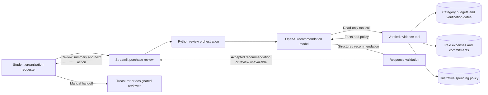
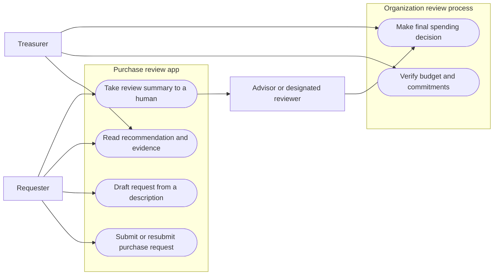
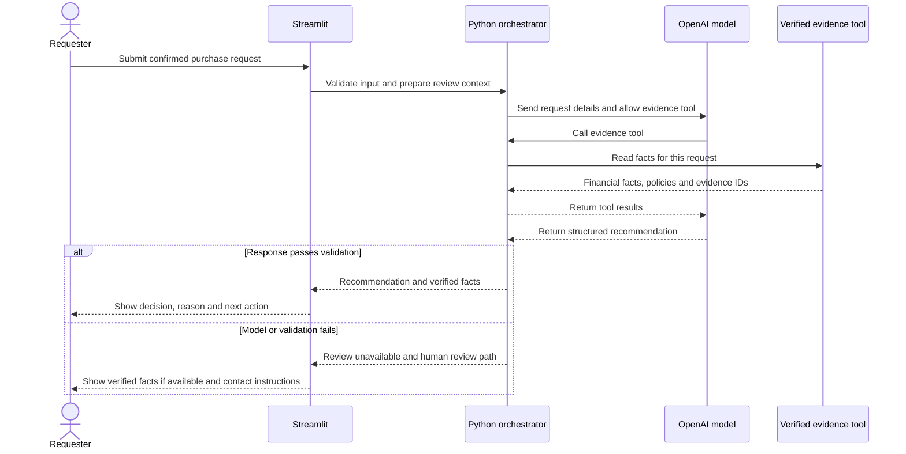
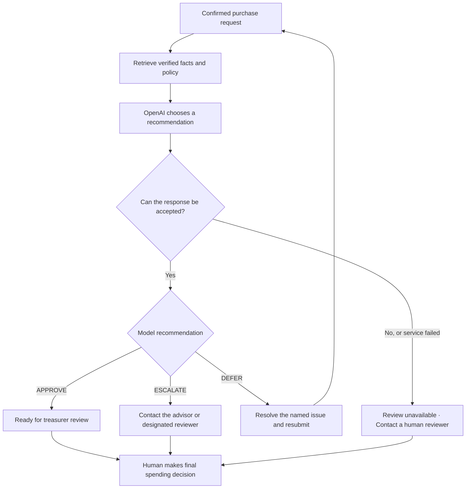

# Campus Organization Spending Review Agent

A local decision-support prototype for student organization treasurers. All data is mock and all policies are illustrative, **not official CMU policy**. APPROVE is a recommendation only. The app has no payment, authorization, or budget-writing capability.

## Current prototype architecture

```text
app.py                 Streamlit form, budget overview, recommendation
review.py              Read-only CSV loading, validation, Decimal calculations, policy checks
agent.py               OpenAI Responses API explanation and read-only tool
data/budgets.csv       Category allocations and reconciliation dates
data/ledger.csv        Paid expenses and outstanding commitments
data/policies.json     Configurable illustrative rules
test_review.py         Financial, decision, data validation, and mocked API tests
requirements.txt       Python dependencies
.env.example           Optional API configuration template
```

The user selects the category or confirms a category suggested by the optional AI draft. Python loads and validates the source files, calculates `available = allocation - paid - commitments`, checks completeness, record freshness, restrictions, and approval thresholds, and selects a recommendation. Decimal arithmetic avoids floating-point currency errors.

Escalation takes priority: a shortfall, restriction, threshold requiring authorization, or urgent unresolved information produces ESCALATE. Other missing information or stale records produces DEFER. Otherwise the recommendation is APPROVE. Urgency alone does not escalate an otherwise complete, compliant request. The authorization threshold is inclusive.

When AI is enabled, the model must call `get_verified_review`, a narrowly defined, read-only tool returning the Python review snapshot. A second model response explains that result. It receives no filesystem access, write tools, raw purchase text, or authority over the decision. The UI always displays Python's result separately. Generated commentary remains fallible; it cannot override the authoritative recommendation. The pattern follows the [official OpenAI function calling documentation](https://developers.openai.com/api/docs/guides/function-calling).

## Install and run

Requires Python 3.11 or newer. Open a terminal in this folder:

```bash
python3 -m venv .venv
source .venv/bin/activate
python -m pip install -r requirements.txt
streamlit run app.py
```

Open the local URL printed by Streamlit, normally http://localhost:8501. Stop with Ctrl+C. The initial review works without an API key.

For optional live AI explanations:

```bash
cp .env.example .env
```

Edit `.env` to supply your own `OPENAI_API_KEY` and, if needed, a model your account can access. The sample model is `gpt-4.1-mini`; model access is account dependent. Restart Streamlit after editing configuration, then enable **Add OpenAI explanation** in the sidebar. API calls may incur usage charges. Never commit `.env`. With missing credentials, API errors, or timeouts the app retains its deterministic review and shows a fallback notice.

To draft a request with the configured API key, open **Draft with AI**, describe the purchase, and click **Draft request**. The draft text is sent to OpenAI. Check the suggested fields, fill in missing details, and confirm the category and date before submitting for a rule-based review.

## Try the example

Click **Try a sample request** to fill in a $450 van request. Travel allocation is $2,000 minus $800 paid = $1,200 before commitments. The $900 hotel commitment leaves $300, so the shortfall is $150. The deadline defaults to tomorrow. Select **Review purchase** to see ESCALATE and next steps.

To see APPROVE, use a $100 Travel request with all fields completed and current records. To see DEFER, leave the vendor blank, use a $100 request, and choose a deadline a week away. An urgent request with missing information escalates.

Sample records were verified on **November 11, 2026**. After 14 days they intentionally become stale. Update `verified_on` only after reconciling the entire category, including commitments; do not automatically refresh it when the app starts. The real current date drives review freshness and deadlines.

## Configure data and policies

Each budget category must be unique. Each ledger ID must be unique across paid and committed entries. When a commitment is paid, change its status to `paid`; do not retain a second committed row for the same obligation. Use USD amounts with at most two decimal places and no dollar signs or thousands separators in CSVs. `verified_on` uses ISO `YYYY-MM-DD`. A category with no ledger entries has zero recorded expenses and commitments; reconciliation must establish that the file is complete.

In `policies.json`, configure the inclusive `approval_threshold`, maximum record age, urgent window, quote requirement, category restrictions, and human escalation authority. A restriction always requires human review; there is no automatic exception approval. Unknown categories/statuses, duplicate IDs/categories, malformed or missing files, and invalid amounts block reviews. Negative available balances are shown rather than hidden. Missing request details and stale or future-dated records prevent an APPROVE recommendation.

## Validation

```bash
python -m unittest -v
```

Tests cover the $150 shortfall, exact budget boundary, all three outcomes, urgent missing information, stale/future records, threshold and restriction checks, duplicate ledger IDs, invalid amounts, deadlines, and the mocked OpenAI tool exchange. No API key is needed for tests.

## Target design · OpenAI-led purchase review

**OpenAI selects the recommendation.** The model reads the request in context, calls a read-only evidence tool, and returns **APPROVE**, **DEFER**, or **ESCALATE**. Python supplies authoritative budget facts and enforces mandatory policy constraints when accepting a response. A human retains spending authority.

The diagrams below describe the target design. The runnable prototype above still generates recommendations in Python and uses OpenAI for optional drafting and explanations.

### System architecture



| Component | Responsibility |
|---|---|
| Streamlit | Collect confirmed inputs and display one recommendation, its reason, the next action, and the source facts. |
| Python evidence tool | Load and validate source records. Compute amounts with decimal arithmetic and return read-only facts, relevant policy, and source references. |
| OpenAI model | Interpret the request and policy, identify ambiguity, choose the recommendation, and cite the evidence behind it. |
| Response validator | Check schema, evidence references, and mandatory constraints. Reject unsupported or unsafe responses and expose the human review path. |
| Human reviewer | Reconcile records, resolve policy questions, and decide whether the organization authorizes the purchase. |

### Use cases



The app collects and displays evidence for these use cases. Reconciliation and final authorization take place in the organization's own process. For example, a $450 Travel request with $300 available should lead the model to cite the $150 shortfall and recommend **ESCALATE**. A nonurgent request missing a required quote can receive **DEFER** with an instruction to supply the quote.

### Data flow for a purchase review



1. Validate the submitted amount, category, and date format. Keep unresolved fields visible as missing inputs for the model when review can proceed.
2. Bind the evidence tool to the current request. Return its selected category, allocation, paid expenses, commitments, available funds, projected balance, shortfall, reconciliation date, and configured rules. Include stable evidence IDs for the response to reference.
3. Give the model the relevant request details, including purpose and quote information. Treat requester text as data. Keep credentials, unrelated ledger rows, and write capabilities outside the model context.
4. Require a structured response with a recommendation, a concise reason, evidence IDs, unresolved items, and a next action. On escalation, include the configured reviewer role.
5. Validate the response before display. An invalid response leaves the recommendation unavailable, with a human handoff available.

### Recommendation and human handoff



The validator enforces clear policy requirements. For example, it rejects an **APPROVE** response citing sufficient funds when the evidence shows a shortfall, and rejects any non-escalation recommendation when a verified mandatory escalation rule applies. It also rejects unknown evidence IDs, malformed responses, or approval while required facts remain unresolved. A rejected result is shown as **Review unavailable**, with no substitute recommendation from Python. When possible, the app shows the verified facts so a human can continue the review.

For early demos, escalation is a manual handoff. Show the reviewer role, the request, the triggering concern, and the evidence needed to act. Don’t imply that the app notified anyone. Treat category disagreement and unclear quotes as issues for the model to surface. Ask for clarification when the requester can resolve the issue, or escalate when the policy or urgency calls for human judgment.

### Implementation milestones and acceptance tests

1. **Separate facts from recommendation.** Extract the evidence-building logic from the existing review engine. Preserve the current decimal arithmetic and policy data. Verify that the sample request still shows $300 available and a $150 shortfall.
2. **Implement the model recommendation.** Add a read-only evidence tool and a structured response contract. Test the tool exchange and response validation with mocked API calls.
3. **Wire Streamlit to the model-led path.** Show the accepted model recommendation and supporting facts. Verify that missing credentials, timeouts, and invalid output produce **Review unavailable** with a clear human next action.
4. **Evaluate on live model responses.** Record expected results and the success criterion before execution. Reuse the 12 baseline scenarios and add cases for category mismatch, ambiguous quotes, inaccurate evidence references, and mandatory escalation. Report the model's hit rate and reproduce failures verbatim. Track service failures separately from model errors while counting both as misses for cases that require a recommendation.

The existing **11/12 (91.7%)** result is a baseline for the Python reviewer. It does not measure model-led decision quality.
