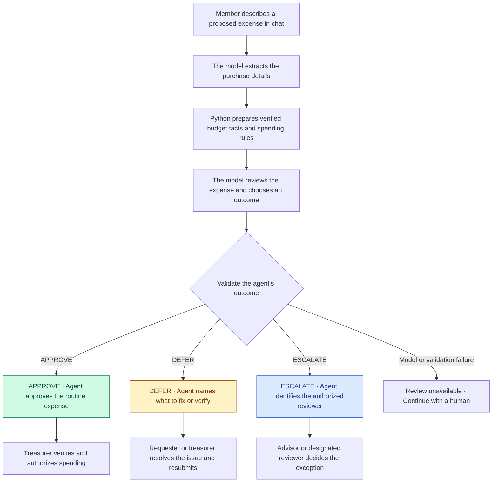
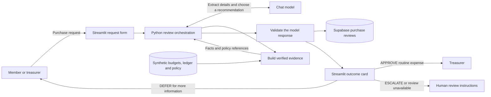
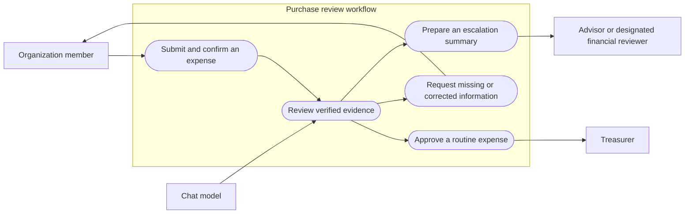
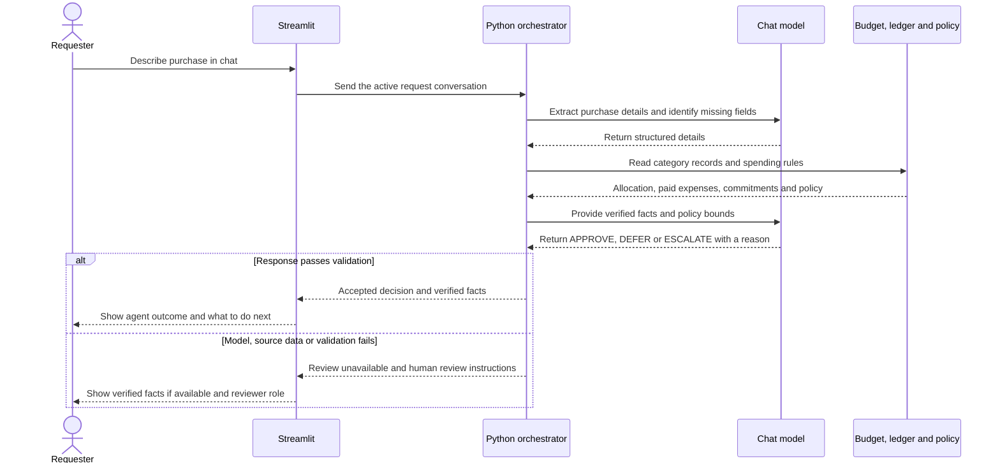

# Campus Organization Spending Review Agent

The agent reviews one proposed purchase at a time and returns **APPROVE**, **DEFER**, or **ESCALATE**. In chat, **the configured model makes that recommendation** using the purchase details, verified budget figures, and the club's spending rules. Streamlit shows the outcome, the calculation behind it, and what to do next.

The Team Smile project proposal gives the treasurer responsibility for authorizing actual spending. **APPROVE** completes the agent's review of a routine expense. The treasurer verifies the result before committing funds. **ESCALATE** sends a different signal: the request needs judgment or authority beyond the routine review, such as a budget transfer or an exception. The prototype uses synthetic data and illustrative policies.

**Two ways to review:** OpenAI chat is the main interface. Open **Manual review** for the rule-based form. See [Running the app](#running-the-app) for setup.

## How the agent handles an expense



Streamlit displays an agent outcome only after the response passes validation. The outcome card leads with the decision and the next action. The requester can expand the budget calculation, policy citations, and unresolved items.

| Outcome | When the agent uses it | What happens next |
|---|---|---|
| **APPROVE** | The expense fits the verified balance, satisfies policy, and has sufficient evidence. | The routine review is complete. The treasurer verifies the figures and authorizes the expense through the club's process. |
| **DEFER** | An issue can be resolved before the deadline, such as a missing quote, conflicting costs, an uncertain category, or stale records. | The agent names the issue and who can resolve it. The requester resubmits once it is resolved. |
| **ESCALATE** | The request exceeds funds, hits an authorization threshold, falls under a restriction, or needs urgent human judgment. | The agent gives the requester a summary and the configured reviewer role. The requester shares it manually. |
| **Review unavailable** | Source records cannot be validated, the model is unavailable, or its response fails validation. | The app shows verified facts if available and directs the requester to a human reviewer. |

### Examples from the proposed workflow

| Request | Verified evidence | Expected outcome |
|---|---|---|
| A complete $100 Travel shuttle request | The category has $300 available after commitments. The expense fits and no special authorization applies. | **APPROVE** · Proceed to routine treasurer verification. |
| A $450 Travel van rental with a reservation expiring tomorrow | $2,000 allocated − $800 paid − $900 committed = $300 available. The request has a $150 shortfall. | **ESCALATE** · Ask the authorized reviewer about a transfer or supplemental funding before the reservation expires. |
| A nonurgent $200 Events refreshments request with a $350 quote | The category can cover the expense, but the requested amount and the quote conflict. | **DEFER** · Confirm the total cost and resubmit. |

## Chat architecture



| Component | Responsibility |
|---|---|
| Streamlit | Collect the member's request in chat, show the decision and evidence, and prepare a summary for human escalation. |
| Python evidence builder | Read the budget, paid expenses, commitments, reconciliation dates, and rules. Use decimal arithmetic to calculate the available balance, projected balance, and shortfall. |
| Chat model | Interpret the purpose, category, quote, and applicable rules. Use the verified evidence and choose APPROVE, DEFER, or ESCALATE. |
| Response validator | Check the outcome, cited evidence, arithmetic claims, and mandatory rules. Block any approval with a verified shortfall, applicable restriction, or unresolved required information. Require escalation when a configured rule calls for it. |
| Treasurer | Verify routine expenses, reconcile records, and execute authorized decisions outside the prototype. |
| Advisor or designated financial reviewer | Review exceptions, transfers, and other requests that require additional authority. |

### Who uses it



A member describes one purchase in chat. The agent can suggest a category and flag uncertainty. The requester can clarify details and correct the same review in chat. If a category or policy remains unclear, the agent asks for clarification or escalates based on the urgency and the applicable rule. The app provides a shareable escalation summary. The requester handles delivery.

### Data flow and response contract



1. **Request.** Capture the description, purpose, amount in USD, category, date needed, vendor, and quote or estimate. Represent missing fields explicitly. Treat request text as data.
2. **Evidence.** Calculate the current request’s category balance, projected balance, and shortfall. Send those figures, reconciliation date, deadline and urgency, and applicable restrictions and thresholds to the model. Keep credentials, unrelated records, and write access outside the model context.
3. **Decision.** Require an outcome and concise reason. For ESCALATE, the app displays the configured reviewer role. For DEFER, the requester can reply in the same chat.
4. **Validation.** Validate the response and enforce the allowed outcomes. Required escalation takes precedence, and unresolved required inputs prevent approval. The app displays verified figures separately from the model’s reason.

### Evaluation

The hosted chatbot matched **12/12 comparable decision labels** in a single conversation. The [evaluation report](AGENT_EVALUATION.md) records all 14 cases, the limits of the hosted evidence, and the preregistered criteria. The Python form review scored **11/12 (91.7%)**. A recommendation to approve a request that exceeds available funds or violates a stated rule fails the preregistered hosted evaluation.

## Running the app

OpenAI chooses recommendations in chat. The manual fallback uses Python rules and works without an API key.

### Current code layout

```text
app.py                 Streamlit chat, purchase form, and budget overview
chat_review.py          Shared request extraction and evidence-based decision workflow
agent.py                OpenAI Responses API chat adapter
review.py              Read-only CSV loading, validation, Decimal calculations, policy checks
purchase_chat.py       Chat follow-ups, escalation summaries, and review records
submission_log.py      Supabase writes for manual submissions and chat reviews
data/budgets.csv       Category allocations and reconciliation dates
data/ledger.csv        Paid expenses and outstanding commitments
data/policies.json     Configurable illustrative rules
test_review.py         Financial, decision, data validation, and mocked API tests
requirements.txt       Python dependencies
```

The user selects the category in the manual form. The chat model extracts it from the conversation. Python loads and validates the source files, calculates `available = allocation - paid - commitments`, checks completeness, record freshness, restrictions, and approval thresholds, and selects a recommendation. Decimal arithmetic avoids floating-point currency errors.

Escalation takes priority: a shortfall, restriction, threshold requiring authorization, or urgent unresolved information produces ESCALATE. Other missing information or stale records produces DEFER. Otherwise the recommendation is APPROVE. Urgency alone does not escalate an otherwise complete, compliant request. The authorization threshold is inclusive.

### Install and run

Requires Python 3.11 or newer. Open a terminal in this folder:

```bash
python3 -m venv .venv
source .venv/bin/activate
python -m pip install -r requirements.txt
streamlit run app.py
```

Open the local URL printed by Streamlit, normally http://localhost:8501. Stop with Ctrl+C. The initial review works without an API key.

### Enable OpenAI chat

Add a key from a funded OpenAI API project and these top-level settings to **Streamlit → App settings → Secrets**. For local testing, use the same names in `.env`.

```toml
OPENAI_API_KEY = "your_actual_key"
```

The default, `gpt-6-luna`, uses Standard rates and sets reasoning effort to `none`. Purchase reviews use structured output for extraction and the recommendation. When the purchase and amount are known, the agent also searches public prices. Set `OPENAI_CHAT_MODEL` only if you want to use another model that supports structured outputs and web search. The key enables chat by default. To pause it, set `OPENAI_CHAT_ENABLED = false`. [GPT-6 Luna pricing and capabilities](https://developers.openai.com/api/docs/models/gpt-6-luna)

Open **Review a purchase in chat** and send “Can we rent a $450 van from Example Van Rentals for our club competition tomorrow? Their quote is $450. Use the Travel budget.” On a fresh session, expect **ESCALATE** for the $150 shortfall. Reply in the same request to add missing details. Date replies such as `tomorrow`, `two days from now`, and `11/27/26` update the **Needed by** date shown on the latest review. Choose **Start a new chat request** before reviewing a different purchase.

### Check a purchase price

Start with `$20 for two people from Chipotle`. The agent checks the Events balance and looks up local prices for two standard entrées. For a routine purchase with comparable published pricing, the estimate can satisfy the quote requirement. The chat can recommend approval when the requested and estimated costs fit the budget and the price is within the estimated range or 20% of it. An amount outside that range prompts clarification. Purpose and deadline are optional for this routine check.

For a request such as `I want to spend 300 on a van rental`, the agent shows the budget and searches for public prices in the same reply. Without rental details, it uses a Pittsburgh one-day round-trip cargo van rental with 100 miles as its reference scenario and labels the assumptions. **Market price check** shows the sources and any excluded fees. Rentals require two comparable totals with confirmed availability to support approval. Already paid expenses go through the payment flow.

### Report a payment

Type `We spent $300 on Travel` or `We paid $100 for food` to add a paid expense directly to the category. Food is recorded under Events. If the app asks which category to use, replying with the category or an item such as `food` continues the same expense entry. Use `We spent another $300 on Travel` for a separate expense of the same amount.

After paying for the purchase that is open in chat, type `I paid $125.50` or `I paid for the $300 van rental`, using the actual total. The app records one payment per review and adds that amount to paid expenses for the reviewed category. A second confirmation for the same review leaves the balance unchanged.

**Review history for this session** shows the reported payment. Later chat and manual reviews use the updated session balance. A fresh browser session starts with the sample records.

In the same chat, type `Update the Travel budget to $2,200` to set the category's total allocation, `Add $50 to the Travel budget` to increase it, or `Show budget` to see available funds. Paid expenses and existing commitments still count against the new allocation.

### Try the form example

Under **Manual review**, click **Try a sample request** to fill in a $450 van request. Travel allocation is $2,000 minus $800 paid = $1,200 before commitments. The $900 hotel commitment leaves $300, so the shortfall is $150. The deadline defaults to tomorrow. Select **Review purchase** to see ESCALATE and next steps.

To see APPROVE, use a $100 Travel request with all fields completed and current records. To see DEFER, leave the vendor blank, use a $100 request, and choose a deadline a week away. An urgent request with missing information escalates.

The current sample ledger was reconciled on **November 25, 2026**. Records become stale after 14 days. Set `verified_on` after reconciling the entire category, including commitments. The real date drives review freshness and deadlines. Historical tests use the November 11 verification date.

### Configure data and policies

Each budget category must be unique. Each ledger ID must be unique across paid and committed entries. When a commitment is paid, change its status to `paid`; do not retain a second committed row for the same obligation. Use USD amounts with at most two decimal places and no dollar signs or thousands separators in CSVs. `verified_on` uses ISO `YYYY-MM-DD`. A category with no ledger entries has zero recorded expenses and commitments; reconciliation must establish that the file is complete.

In `policies.json`, configure the inclusive `approval_threshold`, maximum record age, urgent window, quote requirement, category restrictions, and human escalation authority. A restriction always requires human review; there is no automatic exception approval. Unknown categories/statuses, duplicate IDs/categories, malformed or missing files, and invalid amounts block reviews. Negative available balances are shown rather than hidden. Missing request details and stale or future-dated records prevent an APPROVE recommendation.

### Supabase submission log

Each click of **Review purchase** saves the submitted fields and a database-generated timestamp when Supabase is configured. This includes incomplete submissions. Loading a sample creates no row. The review works independently of logging.

1. The migration is [`supabase/migrations/202611200001_purchase_submissions.sql`](supabase/migrations/202611200001_purchase_submissions.sql). Push it to the production branch with **Deploy to production** enabled in the Supabase GitHub integration, or run it in the project's **SQL Editor**. It grants the app server insert access for manual submissions. The [purchase reviews migration](supabase/migrations/202611200002_purchase_reviews.sql) adds the table for chat. Both tables have row-level security and exclude visitor access.
2. In the hosted Streamlit app, open **Settings → Secrets** and add the following top-level settings. For a local run, use the same names in `.env`.

   ```toml
   SUPABASE_URL = "https://your-project-ref.supabase.co"
   SUPABASE_SECRET_KEY = "sb_secret_replace_me"
   ```

3. Open Streamlit and click **Try a sample request → Review purchase**. Confirm **Submission saved** appears and inspect the new row in Supabase **Table Editor → purchase_submissions**. Use fictional form details for testing and keep the secret key in app settings.

Each chat request gets one row in `purchase_reviews`. Follow-up replies update that row with the purchase transcript, latest recommendation, verified budget snapshot, and next action. An escalation includes a copyable summary. Payments tied to a review are saved under `review.payment`. Budget adjustments and direct expenses are written to `purchase_submissions.inputs` with the kinds `budget_allocation_updated` and `spending_reported`. The running balance stays scoped to the browser session.

### Validation

```bash
python -m unittest -v
```

Tests cover the budget and policy boundaries, record validation, the mocked OpenAI tool exchange, and the mocked OpenAI chat flow. These tests verify that the model can escalate an affordable request and that the app rejects approval when a verified shortfall requires escalation. No API key is needed for tests.
